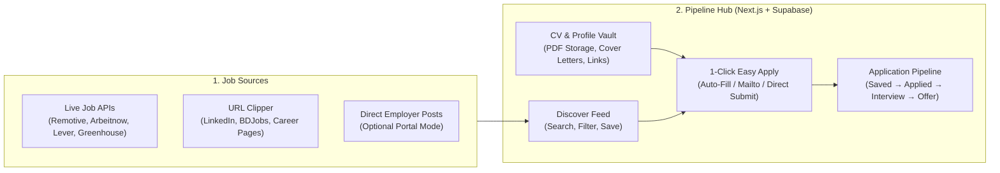

# Pipeline — Job Portal & Career Hub Milestones

This roadmap outlines the phased evolution of **Pipeline (Job Tracker)** from a personal application tracker into a full **LinkedIn / BDJobs-style Career & Job Discovery Platform** with CV management, automated job aggregation, URL auto-scraping, and 1-click "Easy Apply".

---

## Architecture Overview



---

## Milestone 1: Foundation & Zero-Friction Tracker (Completed ✅)
**Goal:** Eliminate form bloat and establish a high-craft, distraction-free UI/UX.
- [x] **Linear / Attio Monochrome Design System**: Crisp zinc/slate surfaces (`#fafafa` / `#09090b`), hairline 1px borders, and `tabular-nums` typography in `src/app/globals.css`.
- [x] **Unified Metrics Ledger**: Compact 4-column status strip (`Total tracked`, `Active pipeline`, `Interviews & offers %`, `Follow-ups due`) in `src/components/StatsBar.tsx`.
- [x] **2-Second Inline Quick Log**: Log applications directly from the main workspace bar (`Company` + `Role` + `Optional URL`) without opening a modal.
- [x] **Progressive Disclosure Modal**: Simplified `src/components/JobModal.tsx` with 1-click stage pills, smart company detection from job URLs, `⌘V` screenshot pasting, and a collapsible drawer for compensation, dates, and recruiter details.

---

## Milestone 2: CV Vault & Candidate Profile Manager
**Goal:** Store all your resumes (PDFs), portfolio links, and cover letter templates inside the app so you never hunt for files when applying.
- [ ] **Multi-CV Storage & Previewer (`src/components/ResumeVaultModal.tsx`)**:
  - Upload and store multiple PDF resumes (e.g., *Frontend CV*, *Full-Stack CV*, *BDJobs Standard CV*) in IndexedDB locally and **Supabase Storage** (`resumes` bucket) in cloud mode.
  - Tag each CV with a target role, set a "Default CV", preview PDFs in-app, and download/attach in one click.
- [ ] **Candidate Quick-Copy Profile**:
  - Store reusable application snippets: Full Name, Email, Phone, LinkedIn, GitHub, Portfolio URL, Expected Salary, Notice Period, and customizable Cover Letter templates.
  - One-click **Copy Profile Snippet** bar in the navbar/modal for instant pasting into external forms.
- [ ] **Job-to-CV Linking**:
  - Select which stored CV version was used when applying to a job so you always know which resume an interviewer is looking at.

---

## Milestone 3: Smart URL Clipper (Auto-Fill from LinkedIn / BDJobs)
**Goal:** Paste a job URL and let the app extract the company, role, location, salary, and description automatically.
- [ ] **Server-Side Metadata & Job Scraper (`src/app/api/clip-job/route.ts`)**:
  - Next.js API route that fetches OpenGraph tags, JSON-LD `JobPosting` schema (used by LinkedIn, BDJobs, Glassdoor, Greenhouse, Lever, Ashby), and page text.
  - Automatically extracts: `company`, `title`, `location`, `workplace` (`Remote`/`Hybrid`/`On-site`), `salary`, `deadline`, and clean `description`.
- [ ] **1-Click "Paste Link to Import"**:
  - Pasting a URL into the Quick Log bar or Modal triggers an instant "Auto-fill from URL" action, populating all fields in under a second.

---

## Milestone 4: Live Job Discovery Feed ("Browse Jobs" Tab) (Completed ✅)
**Goal:** Bring jobs directly into the app like BDJobs and LinkedIn so you can browse, filter, bookmark, and apply without leaving your workspace.
- [x] **Workspace Navigation Tabs (`My Pipeline` | `Discover Jobs`)**:
  - Seamless top-level view switcher in `src/components/Navbar.tsx` and `src/app/page.tsx`.
- [x] **Live Job Aggregator API (`src/app/api/jobs/discover/route.ts`)**:
  - Aggregates real-time job listings across **Bangladesh (`LinkedIn BD` guest scraper + `BDJobs` live search parser)** and **International Remote (`Remotive` + `Arbeitnow` public APIs)**.
  - Filter live jobs by keyword, role preset, market (`All Markets`, `Bangladesh`, `International Remote`), and source.
- [x] **1-Click Save & Apply (`src/components/DiscoverFeed.tsx`)**:
  - Click **Save** on any discovered job to bookmark it into `Saved`, or click **Apply & Track** to launch the posting and automatically log it into your `Applied` pipeline with a 7-day follow-up reminder.

---

## Milestone 5: 1-Click "Easy Apply" Engine
**Goal:** Turn applying and logging into a single unified action.
- [ ] **Easy Apply Drawer (`src/components/EasyApplyModal.tsx`)**:
  - When clicking **Apply** on any job in the `Discover Jobs` feed or `Saved` column:
    1. Automatically selects your best-matching stored CV from the **CV Vault**.
    2. Generates a tailored cover note using your stored template with `{company}` and `{role}` auto-filled.
    3. **Direct Email / Portal Launch**: If the job has an HR email (common on BDJobs), opens a pre-filled email with subject + cover note + CV ready; if it's an external portal link (LinkedIn/Greenhouse), opens the portal while keeping a floating quick-copy strip for your CV and links.
    4. **Auto-Pipeline Promotion**: Automatically marks the job as `Applied`, records today's date, sets a `+7d` follow-up reminder, and attaches the selected CV version.

---

## Milestone 6: Multi-User Portal & Cloud Sync (Optional SaaS Expansion)
**Goal:** Allow multiple users (Candidates & Employers) to sign in, post jobs, and receive applications directly inside the platform.
- [ ] **Supabase Authentication**: Email/Password + Google/GitHub OAuth with Row-Level Security (`user_id` isolation).
- [ ] **Employer Mode ("Post a Job")**: Companies can publish verified job listings directly to the platform's `Discover Jobs` feed.
- [ ] **Instant Native Easy Apply**: Candidates apply to Employer-posted jobs in 1 click without leaving the site—submitting their stored PDF CV and profile straight to the Employer's applicant dashboard.

---

## Database Schema Roadmap (Supabase SQL)

```sql
-- 1. Candidate Profile & Reusable Snippets
CREATE TABLE IF NOT EXISTS public.profiles (
  id TEXT PRIMARY KEY DEFAULT 'default',
  full_name TEXT,
  email TEXT,
  phone TEXT,
  location TEXT,
  linkedin_url TEXT,
  github_url TEXT,
  portfolio_url TEXT,
  expected_salary TEXT,
  notice_period TEXT,
  cover_letter_template TEXT,
  updated_at TIMESTAMPTZ DEFAULT now()
);

-- 2. CV / Resume Vault
CREATE TABLE IF NOT EXISTS public.resumes (
  id TEXT PRIMARY KEY,
  name TEXT NOT NULL,           -- e.g. "Full-Stack Engineer CV"
  target_role TEXT,             -- e.g. "Software Engineer"
  file_name TEXT NOT NULL,
  file_size INTEGER,
  file_data TEXT,               -- Base64 PDF or Supabase Storage URL
  is_default BOOLEAN DEFAULT false,
  created_at BIGINT NOT NULL
);

-- 3. Discovered / Cached Job Feed
CREATE TABLE IF NOT EXISTS public.discovered_jobs (
  id TEXT PRIMARY KEY,
  source TEXT NOT NULL,         -- e.g. "Remotive", "BDJobs", "LinkedIn", "Direct"
  company TEXT NOT NULL,
  company_logo TEXT,
  title TEXT NOT NULL,
  location TEXT,
  workplace TEXT,
  salary TEXT,
  apply_url TEXT NOT NULL,
  apply_email TEXT,
  description TEXT,
  tags TEXT[] DEFAULT '{}',
  posted_at TIMESTAMPTZ,
  created_at BIGINT NOT NULL
);
```

