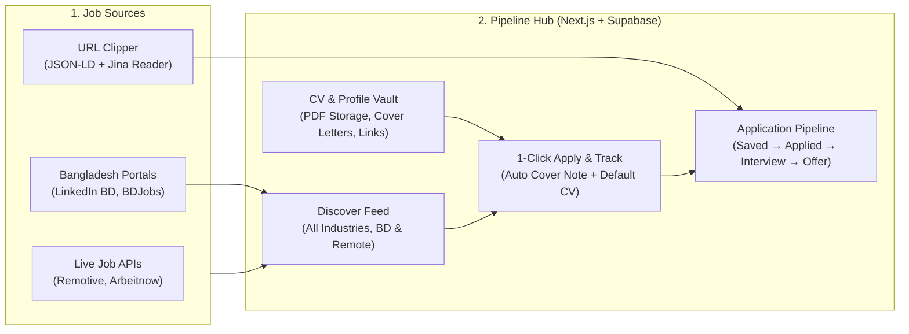

# Pipeline — Job Portal & Career Hub Milestones

This roadmap tracks the evolution of **Pipeline (Job Tracker)** into a full **LinkedIn / BDJobs-style Career & Job Discovery Platform** with CV management, automated job aggregation, URL auto-scraping, and 1-click "Easy Apply".

---

## Architecture Overview

---

## Milestone 1: Foundation & Zero-Friction Tracker (Completed ✅)
- [x] **Linear / Attio Monochrome Design System**: Crisp zinc/slate surfaces (`#fafafa` / `#09090b`), hairline 1px borders, and `tabular-nums` typography in `src/app/globals.css`.
- [x] **Unified Metrics Ledger**: Compact 4-column status strip (`Total tracked`, `Active pipeline`, `Interviews & offers %`, `Follow-ups due`) in `src/components/StatsBar.tsx`.
- [x] **2-Second Inline Quick Log**: Log applications directly from the main workspace bar (`Company` + `Role` + `Optional URL`) in `src/app/page.tsx`.
- [x] **Progressive Disclosure Modal**: Streamlined `src/components/JobModal.tsx` with 1-click stage pills, smart company detection from job URLs, `⌘V` screenshot pasting, and a collapsible drawer for compensation, dates, and recruiter details.

---

## Milestone 2: CV Vault & Candidate Profile Manager (Completed ✅)
- [x] **Multi-CV Storage & Previewer (`src/components/CvVaultModal.tsx` & `src/lib/cv-storage.ts`)**:
  - Upload and store multiple PDF resumes in IndexedDB, tag each with a custom label, set a Default CV, preview PDFs in-browser, and download in 1 click.
- [x] **Candidate Quick-Copy Profile**:
  - Store reusable application snippets (Full Name, Email, Phone, LinkedIn, Portfolio URL, Expected Salary) and a customizable Cover Note template (`{company}`, `{role}`, `{name}`).

---

## Milestone 3: Smart URL Clipper (Auto-Fill from LinkedIn / BDJobs) (Completed ✅)
- [x] **Server-Side Metadata & Job Scraper (`src/app/api/clip-job/route.ts`)**:
  - Extracts `JobPosting` JSON-LD schema, OpenGraph tags, and falls back to `r.jina.ai` to populate Company, Role, Location, Workplace, Salary, and Notes from any pasted URL.
- [x] **1-Click "Auto-fill" in Modal**:
  - Pasting a URL in `src/components/JobModal.tsx` reveals an instant **Auto-fill** button.

---

## Milestone 4: Live Job Discovery Feed ("Discover Jobs" Tab) (Completed ✅)
- [x] **Workspace Navigation Tabs (`My Pipeline` | `Discover Jobs`)**:
  - Top-level switcher in `src/components/Navbar.tsx` and `src/app/page.tsx`.
- [x] **Live Multi-Industry Job Aggregator (`src/app/api/jobs/discover/route.ts`)**:
  - Real-time aggregation across **Bangladesh (`LinkedIn BD` + `BDJobs`)** and **International Remote (`Remotive` + `Arbeitnow`)** supporting all industries (Marketing, Finance & Banking, Sales, HR, Customer Support, Operations, MTO, NGO, Design, Software).

---

## Milestone 5: 1-Click "Apply & Track" Engine (Completed ✅)
- [x] **Unified Apply Workflow (`src/components/DiscoverFeed.tsx`)**:
  - Clicking **Apply & Track** opens the job posting, automatically copies a tailored cover note for `{company}` and `{role}` to the clipboard, links your Default CV version, and logs the job into `Applied` with a 7-day follow-up reminder.

---

## Milestone 6: Deployment & Optional Power-Ups (Next Up 🚀)
- [ ] **GitHub + Vercel + Supabase Cloud Deployment**:
  - Push repository to GitHub, import into Vercel, and connect Supabase (`supabase-schema.sql`) for cross-device sync.
- [ ] **1-Click Follow-Up Message Generator (Optional)**:
  - Generate and copy a polite 7-day follow-up email / LinkedIn message directly from any due card.
- [ ] **Multi-User Portal & Employer Job Posting (Optional SaaS Expansion)**:
  - Add Supabase Auth so external candidates and employers can sign in and post/apply natively.
